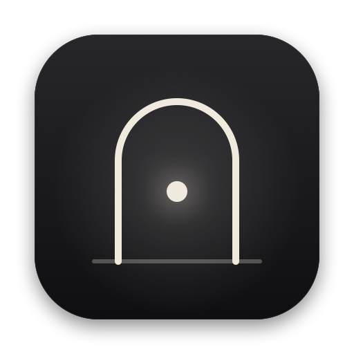
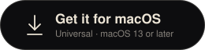
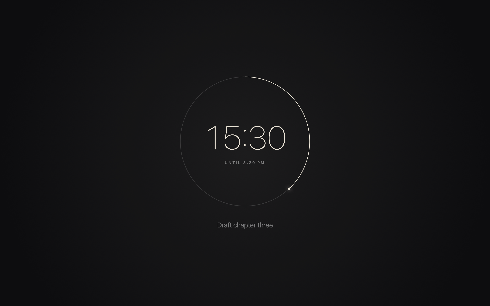
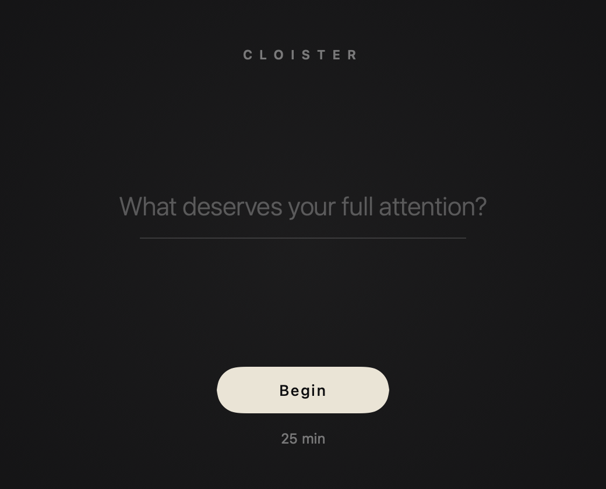
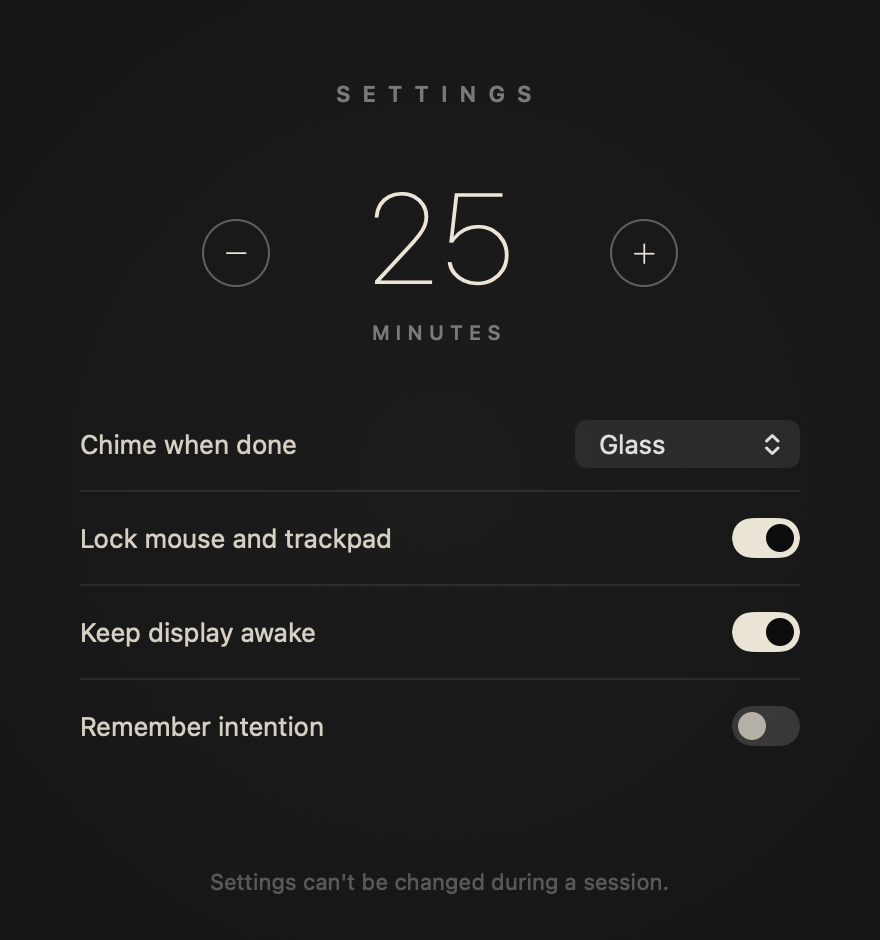

<p align="center">
  
</p>

<h1 align="center">Cloister</h1>

<p align="center">
  A focus timer for macOS that you can't walk out of.<br>
  Name what deserves your attention, press Begin, and your Mac is yours again when the timer says so. Not a second before.
</p>

<p align="center">
  <a href="https://github.com/ArfiArfath21/cloister/releases/latest"></a>
  
  <a href="LICENSE"></a>
</p>

<p align="center">
  <a href="https://github.com/ArfiArfath21/cloister/releases/latest/download/Cloister.dmg"></a>
</p>

<p align="center">
  
</p>

## Why

Most focus timers ask you nicely. You can always pause, skip or quit, and when the urge to check something hits, you do.
Cloister takes that option away. A cloister is the walled-off part of a monastery where the outside world doesn't reach;
for one session, that's your Mac.

## What a session locks

| | |
|---|---|
| Keyboard, mouse, trackpad | Every input event is swallowed system-wide, including Cmd+Q, Cmd+Tab, Spotlight and media keys. The cursor is hidden and frozen (the mouse lock can be turned off). |
| Other apps | Dock, menu bar, app switching and Mission Control are disabled. |
| Getting out | Force Quit (Cmd+Opt+Esc), log out and restart are disabled. There is no cancel button. |
| Displays | Every connected screen is covered, including ones plugged in mid-session. |
| Sleep | The display is kept awake so the countdown stays visible (configurable). |

When the time is up, a soft chime plays, everything is released and the screen shows **Done**.

<p align="center">
  
</p>

## Safety

Cloister is meant to be strict, not dangerous.

- **Crash means unlocked.** The lock is made of things macOS ties to the Cloister process (kiosk presentation options, an event tap, a cursor freeze). If the app dies for any reason, the OS drops all of them immediately.
- **Watchdog.** A background timer independent of the UI exits the app 20 seconds after the session should have ended, in case the main thread ever hangs.
- **Wall-clock deadline.** Sleeping the Mac or closing the lid doesn't extend a session.
- **Hard power-off** (hold the power button) always works. That's the only way out mid-session.

## Install

1. [Download `Cloister.dmg`](https://github.com/ArfiArfath21/cloister/releases/latest/download/Cloister.dmg), open it, and drag **Cloister** onto the **Applications** folder in the window that appears. Then eject the Cloister disk.
2. Open Cloister from Applications or Launchpad. The first launch needs one extra step, see [Opening Cloister the first time](#opening-cloister-the-first-time) below.
3. Click **Allow input lock** and switch Cloister on in **System Settings → Privacy & Security → Accessibility**. Begin stays disabled until it's granted, because without it the keyboard can't be locked.

### Opening Cloister the first time

Cloister is signed, but not notarized by Apple (that needs a paid Apple Developer account). So the first time you open it, macOS says it *"can't be opened"* or *"cannot verify that it is free of malware"*. Pick one of these; you only have to do it once.

**Option A: Terminal (any macOS version, quickest)**

```bash
xattr -dr com.apple.quarantine /Applications/Cloister.app
```

Then open Cloister normally.

**Option B: System Settings (macOS 15 Sequoia and later)**

1. Double-click Cloister and dismiss the warning with **Done**.
2. Open **System Settings → Privacy & Security** and scroll to the **Security** section.
3. Next to *"Cloister was blocked to protect your Mac"*, click **Open Anyway**, then confirm with your password or Touch ID.

**Option C: Right-click (macOS 14 Sonoma and earlier)**

Right-click (or Control-click) `Cloister.app`, choose **Open**, then click **Open** in the dialog.

## Settings

Open **Cloister → Settings…** from the menu bar, press **⌘,**, or click the duration under Begin.

<p align="center">
  
</p>

| Setting | Default | |
|---|---|---|
| Session length | 25 min | 1 to 120 minutes. Use 1 minute to try the lock out safely. |
| Chime when done | Glass | One of the macOS system sounds, or none. |
| Lock mouse and trackpad | On | Off locks only the keyboard; the cursor still moves, but there's nothing to click except the timer. |
| Keep display awake | On | Off lets the display sleep on its usual schedule. The session keeps running. |
| Remember intention | Off | Keeps the last intention in the field for the next session. |

Settings can't be opened during a session.

## Build from source

Requires Xcode command line tools (Swift 5.9+).

```bash
./build.sh          # build/Cloister.app
./build.sh --dmg    # also packages build/Cloister.dmg, the drag-to-Applications installer
```

Builds are universal (Apple silicon and Intel) and ad-hoc signed. macOS ties the Accessibility grant to the exact build, so after rebuilding, remove the old Cloister entry in the Accessibility list and add the new one.

The icon, installer background and README screenshots are generated from code:

```bash
swift Tools/make-icon.swift
swift Tools/make-dmg-art.swift
swiftc -parse-as-library Sources/Session.swift Sources/Views.swift Sources/SettingsView.swift Tools/render-screens.swift -o build/render && build/render
```

## How it works

| File | Role |
|---|---|
| [`Lockdown.swift`](Sources/Lockdown.swift) | Kiosk presentation options, a session-wide `CGEventTap` that drops every event, cursor freeze, display-sleep assertion, watchdog |
| [`AppDelegate.swift`](Sources/AppDelegate.swift) | Session flow and one shielding-level window per display |
| [`Views.swift`](Sources/Views.swift) | The SwiftUI start and lock screens |
| [`SettingsView.swift`](Sources/SettingsView.swift) | The Settings window |
| [`Session.swift`](Sources/Session.swift) | Session state and stored preferences |

## License

[MIT](LICENSE)
